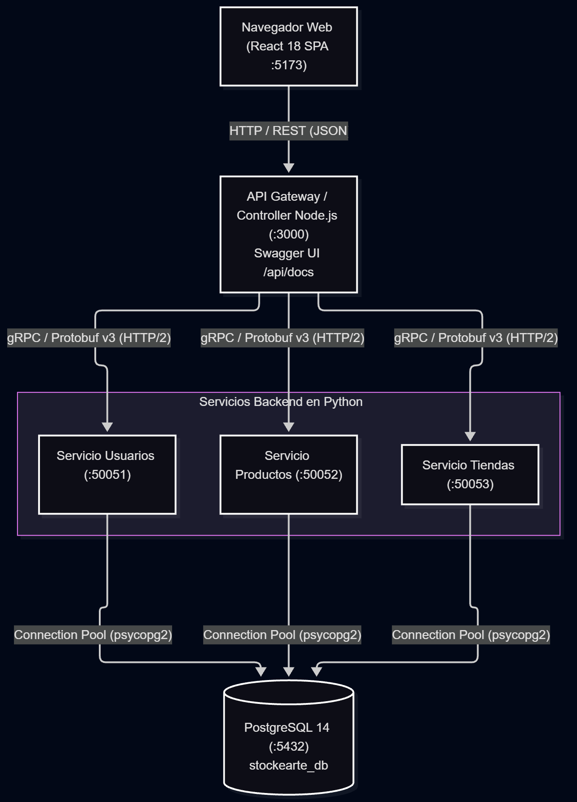
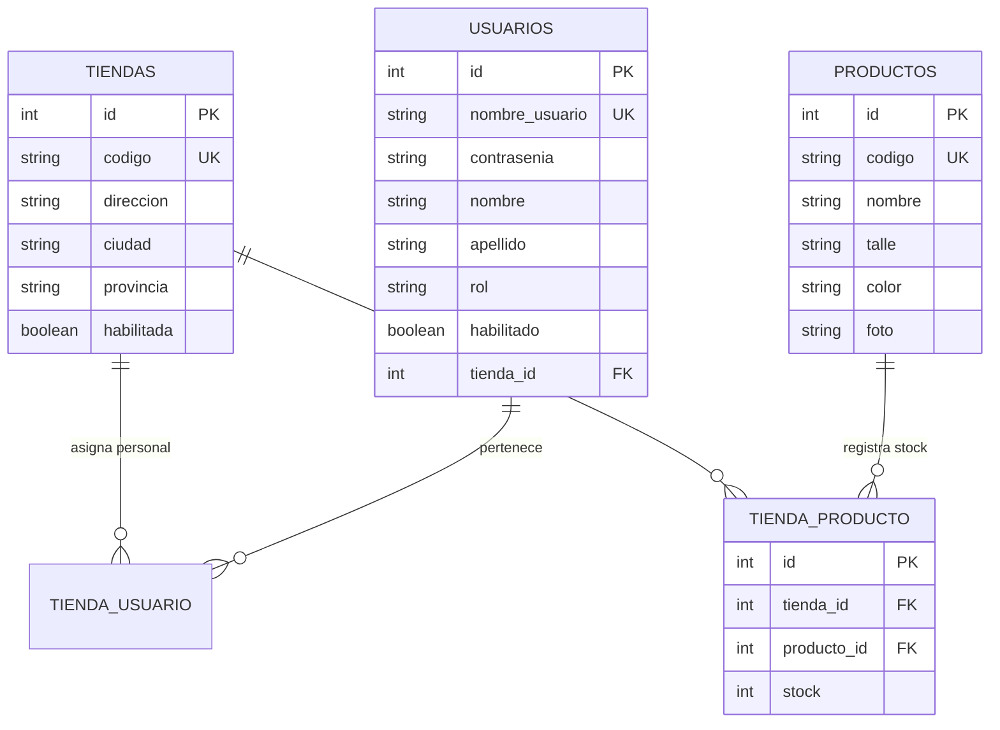

# 📦 Stockearte - Sistema de Gestión de Stock Distribuido

Sistema distribuido para la administración de inventario, sucursales físicas, operadores y control de stock de indumentaria. Implementa una arquitectura desacoplada de microservicios políglotas comunicados mediante llamadas remotas binarias **gRPC** sobre **Protocol Buffers**, coordinados por un **API Gateway** en **Node.js** y consumidos por un cliente web **SPA** en **React**.

---

## 🏛️ Arquitectura del Sistema

La arquitectura separa la presentación web, el enrutamiento y la persistencia en capas independientes conectadas mediante una red virtual privada:

<p align="center">
  
</p>

### Flujo de Comunicación:
1. El cliente web interactúa con el sistema mediante peticiones HTTP/REST enviando y recibiendo payloads JSON.
2. El API Gateway recibe las solicitudes, valida los parámetros y ejecuta llamadas gRPC hacia los microservicios correspondientes.
3. Los microservicios en Python resuelven la lógica de negocio y persisten los cambios en PostgreSQL mediante pools de conexiones dedicados.
4. La base de datos y los microservicios operan dentro de una red virtual privada (`stockearte-net`), sin exponer puertos al exterior.

---

## 🛠️ Tecnologías Principales (General)

| Capa | Tecnologías | Propósito |
| :--- | :--- | :--- |
| **Frontend Web** | React 18, Vite 5, TailwindCSS 3, React Router v7 | Interfaz SPA reactiva, diseño responsive y control de acceso basado en roles (RBAC) |
| **API Gateway** | Node.js 20, Express, `@grpc/grpc-js`, Swagger UI | Punto de entrada REST, clientes gRPC promisificados y documentación OpenAPI 3.0 |
| **Microservicios Backend** | Python 3.11, `grpcio`, `protobuf`, `psycopg2-binary` | Lógica de negocio distribuida, serialización binaria y connection pooling relacional |
| **Contratos de Datos** | Protocol Buffers v3 (`proto3`), Buf CLI | Definición de esquemas neutros (IDL) y reglas de linting para compatibilidad |
| **Base de Datos** | PostgreSQL 14 Alpine | Persistencia relacional ACID de usuarios, sucursales y catálogo de artículos |
| **Contenedores y Red** | Docker, Docker Compose, Nginx Alpine | Empaquetado multi-stage, aislamiento de red bridge y reverse proxy en producción |

---

## 🔌 Servicios y Puertos

| Componente | Directorio | Tecnología | Puerto | Descripción |
| :--- | :--- | :--- | :---: | :--- |
| **Frontend Web** | [`frontend/`](frontend/README.md) | React 18 + Vite + TailwindCSS | `5173` | Cliente SPA con interfaz adaptada por roles y dark mode |
| **API Gateway** | [`controller/`](controller/README.md) | Node.js 20 + Express | `3000` | Punto de entrada REST, traducción a gRPC y Swagger UI |
| **Servicio Usuarios** | `services/usuarios/` | Python 3.11 + gRPC | `50051` | Autenticación, altas, bajas y asignación de operadores |
| **Servicio Productos** | `services/productos/` | Python 3.11 + gRPC | `50052` | Catálogo de artículos, código inmutable y stock por sucursal |
| **Servicio Tiendas** | `services/tiendas/` | Python 3.11 + gRPC | `50053` | Gestión de sucursales físicas, habilitación y asignaciones |
| **Base de Datos** | `database/` | PostgreSQL 14 Alpine | `5432` | Almacenamiento relacional de usuarios, tiendas y catálogo |
| **Contratos gRPC** | [`proto/`](proto/README.md) | Protocol Buffers (proto3) | — | Esquemas `.proto` compartidos entre Node.js y Python |

---

## 📂 Estructura del Repositorio

El proyecto organiza sus componentes en módulos desacoplados:

```bash
TP-Sistemas-Distribuidos-2024/
├── controller/          # API Gateway REST (Node.js + Express)
├── frontend/            # Single Page Application (React 18 + Vite + TailwindCSS)
├── proto/               # Contratos Protocol Buffers (proto3) y configuración Buf
├── services/            # Microservicios gRPC en Python
│   ├── usuarios/        # Microservicio de autenticación y operadores (:50051)
│   ├── productos/       # Microservicio de catálogo y stock (:50052)
│   ├── tiendas/         # Microservicio de sucursales físicas (:50053)
│   ├── common/          # Pool de conexiones PostgreSQL y utilidades compartidas
│   └── requirements.txt # Dependencias de Python para los microservicios
├── database/            # Scripts DDL de inicialización y semillas (PostgreSQL)
│   ├── init.sql         # Esquema de tablas y datos semilla iniciales
│   └── seed.py          # Script Python de sembrado para ejecución local
├── docs/                # Consignas del trabajo práctico e informes de arquitectura
├── docker-compose.yml   # Orquestación de contenedores y red privada virtual
├── .env.example         # Plantilla de variables de entorno globales
└── README.md            # Esta documentación principal
```

---

## 🗄️ Modelo de Datos y Persistencia

El almacenamiento relacional utiliza PostgreSQL (`stockearte_db`). Cada microservicio asume la responsabilidad exclusiva sobre su dominio de datos:



### Responsabilidad de Datos por Microservicio:
* **Microservicio de Usuarios:** Administra la tabla `usuarios` (credenciales, roles `CASA_CENTRAL` o `TIENDA`, sucursal de pertenencia y estado operativo).
* **Microservicio de Tiendas:** Administra las tablas `tiendas` (código alfanumérico unívoco, ubicación geográfica, estado de habilitación) y `tienda_usuario` (vinculación de personal).
* **Microservicio de Productos:** Administra las tablas `productos` (código inmutable de 10 caracteres, nombre, talle, color, foto) y `tienda_producto` (stock disponible por sucursal).

---

## ⚙️ Variables de Entorno Globales

El sistema utiliza un archivo central `.env` en la raíz del repositorio. Las variables configuran los accesos de base de datos, puertos HTTP y resolución de red:

| Variable | Servicio que la Consume | Valor por Defecto / Ejemplo | Descripción |
| :--- | :--- | :--- | :--- |
| `DB_HOST` | Microservicios Python | `database` (Docker) / `localhost` | Host del servidor PostgreSQL |
| `DB_PORT` | Microservicios Python | `5432` | Puerto TCP de la base de datos |
| `DB_NAME` | PostgreSQL / Python | `stockearte_db` | Nombre de la base de datos relacional |
| `DB_USER` | PostgreSQL / Python | `postgres` | Usuario administrador de la base de datos |
| `DB_PASSWORD` | PostgreSQL / Python | `postgres` | Contraseña de acceso a PostgreSQL |
| `PORT` | API Gateway (Node.js) | `3000` | Puerto HTTP en el que escucha el controlador REST |
| `USUARIOS_URL` | API Gateway (Node.js) | `service-usuarios:50051` | Dirección de red del microservicio de Usuarios |
| `PRODUCTOS_URL` | API Gateway (Node.js) | `service-productos:50052` | Dirección de red del microservicio de Productos |
| `TIENDAS_URL` | API Gateway (Node.js) | `service-tiendas:50053` | Dirección de red del microservicio de Tiendas |
| `VITE_API_URL` | Frontend Web (Vite) | `http://localhost:3000/api` | Endpoint REST consumido por la SPA en el navegador |

---

## 🚀 Puesta en Marcha con Docker Compose

Docker Compose compila e inicializa todo el ecosistema en contenedores con un único comando:

### 1. Configuración de Entorno
Copia la plantilla de variables de entorno antes de iniciar:

```bash
# En Windows (PowerShell / CMD)
copy .env.example .env

# En Linux / macOS
cp .env.example .env
```

### 2. Iniciar Servicios

```bash
# Compilar e iniciar todos los contenedores en segundo plano
docker compose up --build -d
```

### 3. Verificar Disponibilidad

Una vez iniciados los contenedores, accede a los siguientes endpoints:
* **Frontend Web (SPA):** [http://localhost:5173](http://localhost:5173)
* **Documentación Swagger UI:** [http://localhost:3000/api/docs](http://localhost:3000/api/docs)
* **API Gateway Health Check:** [http://localhost:3000/api/health](http://localhost:3000/api/health)

### 4. Detener el Stack

```bash
docker compose down
```

---

## 💻 Ejecución Local sin Docker

Para ejecutar cada servicio de forma individual en el sistema operativo:

### 1. Base de Datos PostgreSQL
1. Inicia una instancia local de PostgreSQL en el puerto `5432`.
2. Crea la base de datos `stockearte_db`.
3. Ejecuta el script de inicialización con el esquema y los datos iniciales:
   ```bash
   python database/seed.py
   ```

### 2. Microservicios gRPC en Python
1. Crea y activa un entorno virtual de Python:
   ```bash
   python -m venv .venv
   # Windows:
   .venv\Scripts\activate
   # Linux/macOS:
   source .venv/bin/activate
   ```
2. Instala las dependencias:
   ```bash
   pip install -r services/requirements.txt
   ```
3. Inicia cada servicio en terminales independientes:
   ```bash
   # Terminal 1: Usuarios
   python services/usuarios/server.py

   # Terminal 2: Productos
   python services/productos/server.py

   # Terminal 3: Tiendas
   python services/tiendas/server.py
   ```

### 3. API Gateway / Controller (Node.js)
```bash
cd controller
npm install
npm run dev
```
*(El servidor escucha en `http://localhost:3000`).*

### 4. Frontend Web (React + Vite)
```bash
cd frontend
npm install
npm run dev
```
*(El cliente escucha en `http://localhost:5173`).*

---

## 🧪 Pruebas y Verificación del Sistema

Procedimiento para validar el correcto funcionamiento de cada componente:

### 1. Verificación de Salud del API Gateway
Realiza una petición HTTP al endpoint de monitoreo:
```bash
curl -I http://localhost:3000/api/health
```
*Resultado esperado:* Código de estado `HTTP/1.1 200 OK` con payload JSON `{ "status": "UP", "timestamp": ... }`.

### 2. Exploración Interactiva en Swagger UI
1. Abre [http://localhost:3000/api/docs](http://localhost:3000/api/docs) en el navegador.
2. Ejecuta una petición de prueba a `GET /api/productos` para verificar que el Gateway consulte al microservicio gRPC de productos y devuelva el catálogo.

### 3. Flujos de Prueba en la Interfaz Web (SPA)
* **Prueba A — Operador Casa Central (`admin` / `admin123`):**
  1. Inicia sesión en [http://localhost:5173](http://localhost:5173).
  2. Verifica el acceso a las pestañas **Tiendas**, **Usuarios** y **Productos**.
  3. Abre el modal de detalle de un producto y confirma que muestra el desglose de stock de todas las sucursales del país.
* **Prueba B — Operador Tienda Habilitada (`AnaG20` / `123456`):**
  1. Inicia sesión con la cuenta asignada a `SUC-PALERMO-01`.
  2. Confirma que las pestañas administrativas de tiendas y usuarios quedan ocultas.
  3. Modifica las unidades de stock de una prenda y verifica la actualización inmediata.
* **Prueba C — Operador Tienda Inhabilitada (`AndresG` / `123456`):**
  1. Inicia sesión con la cuenta asignada a `SUC-MARPLAT-01` (sucursal inhabilitada).
  2. Confirma que la interfaz muestra un banner de advertencia (`ShieldAlert`) informando la suspensión operativa.
  3. Verifica que los controles de modificación de stock se encuentran bloqueados.

### 4. Validación de Contratos Protobuf (Buf Lint)
Para verificar que las definiciones `.proto` cumplan con los estándares de diseño:
```bash
cd proto
buf lint
```
*Resultado esperado:* Finalización sin errores de sintaxis ni violaciones de nomenclatura.

---

## 👥 Credenciales de Prueba

La base de datos incluye cuentas preconfiguradas para probar ambos roles operativos:

| Usuario | Contraseña | Rol | Tienda Asignada | Estado Operativo |
| :--- | :--- | :--- | :--- | :---: |
| **admin** | `admin123` | Casa Central | — | Habilitado |
| **AnaG20** | `123456` | Tienda | SUC-PALERMO-01 | Habilitada |
| **CarlosL** | `123456` | Tienda | SUC-CORDOBA-01 | Habilitada |
| **LuciaM** | `123456` | Tienda | SUC-ROSARIO-01 | Habilitada |
| **AndresG** | `123456` | Tienda | SUC-MARPLAT-01 | **Inhabilitada** *(Muestra banner de bloqueo)* |
| **Enzo30** | `123456` | Casa Central | — | Habilitado |

---

## 📋 Reglas de Negocio Implementadas

1. **Código de producto inmutable:** Cada artículo recibe un código alfanumérico aleatorio de 10 caracteres al momento del alta. El sistema no permite modificar este identificador.
2. **Stock descentralizado por sucursal:** El inventario se gestiona de forma independiente por cada tienda física. Al vincular un producto a una tienda, el stock inicial se establece en `0`.
3. **Control de acceso por roles (RBAC):**
   * **Casa Central:** Administra tiendas, crea productos, audita el stock global de todas las sucursales y asigna personal.
   * **Tienda:** Visualiza únicamente los productos vinculados a su sucursal y sólo puede modificar el stock de su tienda asignada.
4. **Protección ante sucursales inhabilitadas:** Si Casa Central inhabilita una tienda física, los operadores de esa sucursal ven su panel bloqueado con una advertencia preventiva, y el backend rechaza cualquier modificación de stock.

---

## 📚 Documentación Técnica Específica

Para conocer los detalles de implementación de cada componente, consulta su documentación dedicada:

* [**Documentación del API Gateway / Controller**](controller/README.md) — Endpoints REST, mapeo de llamadas gRPC promisificadas y Swagger UI.
* [**Documentación del Frontend Web (SPA)**](frontend/README.md) — Arquitectura de componentes React, manejo de estado global, TailwindCSS y despliegue Nginx.
* [**Documentación de Contratos gRPC / Protobuf**](proto/README.md) — Especificación de esquemas `.proto`, reglas de linting con Buf y compilación de stubs.