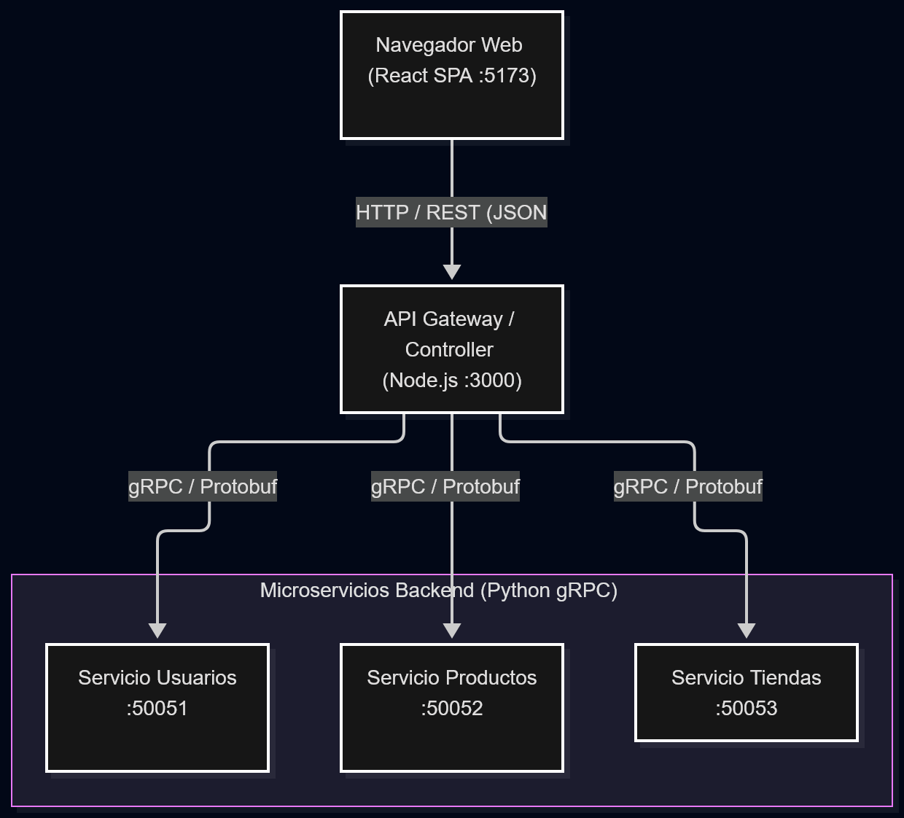

# 🌐 Stockearte - API Gateway / Controlador REST

API Gateway del sistema distribuido **Stockearte** desarrollado en **Node.js** y **Express**. Recibe peticiones HTTP/REST desde el cliente web (SPA) y las traduce a llamadas remotas binarias **gRPC** sobre **Protocol Buffers** hacia los microservicios backend en Python.

---

## 1. Rol del API Gateway

El API Gateway funciona como **punto único de entrada (Single Point of Entry)** entre el navegador y la red interna de microservicios:
* **Traducción de protocolos:** Convierte payloads `JSON` recibidos por HTTP/1.1 en mensajes serializados `Protobuf` sobre HTTP/2 hacia los servicios gRPC.
* **Desacoplamiento de red:** El cliente web se comunica únicamente con el endpoint REST (`http://localhost:3000`). No requiere acceso directo a los puertos gRPC de los microservicios.
* **Orquestación de llamadas:** Coordina operaciones que involucran a más de un servicio (por ejemplo, asignar usuarios a una tienda en el servicio de tiendas y actualizar su asignación en el servicio de usuarios).

---

## 2. Arquitectura y Componentes

El Gateway se ubica entre la SPA de React y los microservicios gRPC en Python:

<p align="center">
  
</p>

### Componentes Principales:
* **Enrutamiento REST (`src/routes/`):** Define los endpoints públicos organizados por recurso (`auth`, `usuarios`, `tiendas`, `productos`).
* **Clientes gRPC (`src/grpcClients.js`):** Carga los esquemas `.proto`, inicializa los canales gRPC y envuelve los métodos en promesas (`async/await`).
* **Documentación OpenAPI (`src/swagger.js`):** Expone la interfaz de Swagger UI para probar los endpoints desde el navegador.

---

## 3. Tecnologías

| Tecnología | Versión | Rol / Propósito |
| :--- | :---: | :--- |
| **Node.js** | `>= 18.x` / `20-alpine` | Entorno de ejecución asíncrono para JavaScript del lado del servidor |
| **Express.js** | `^4.21.1` | Framework web para enrutamiento HTTP y middlewares |
| **@grpc/grpc-js** | `^1.12.2` | Implementación pura de JavaScript para clientes gRPC |
| **@grpc/proto-loader** | `^0.7.13` | Carga dinámica de archivos de esquema `.proto` en tiempo de ejecución |
| **Swagger UI Express** | `^5.0.1` | Servidor de interfaz gráfica para la especificación OpenAPI |
| **CORS** | `^2.8.5` | Middleware para permitir peticiones de origen cruzado desde la SPA |
| **Protocol Buffers** | `proto3` | Esquemas y contratos de datos compartidos entre Node.js y Python |

---

## 4. Estructura del Proyecto

```bash
controller/
├── Dockerfile                  # Construcción de la imagen Docker optimizada para producción
├── package.json                # Dependencias, scripts y metadatos del proyecto
├── README.md                   # Esta documentación técnica
└── src/
    ├── index.js                # Punto de entrada: inicialización de Express y middlewares
    ├── grpcClients.js          # Clientes gRPC promisificados y carga de esquemas .proto
    ├── swagger.js              # Especificación OpenAPI y montaje de Swagger UI
    └── routes/
        ├── auth.routes.js      # Rutas de autenticación y login de operadores
        ├── productos.routes.js # Rutas de catálogo, fotos y control de stock
        ├── tiendas.routes.js   # Rutas de sucursales, estado y asignación de recursos
        └── usuarios.routes.js  # Rutas de administración de operadores y privilegios
```

---

## 5. Requisitos Previos

Requisitos para ejecutar el controlador de forma nativa o en contenedores:

* **Node.js:** Versión `18.x` o superior (`node -v`).
* **Gestor de paquetes:** `npm` (v9+) o `pnpm`.
* **Microservicios gRPC activos:** Servidores Python escuchando en los puertos `50051` (Usuarios), `50052` (Productos) y `50053` (Tiendas).
* **Archivos `.proto`:** Directorio `proto/` en la raíz con `usuario.proto`, `tienda.proto` y `producto.proto`.

---

## 6. Configuración y Variables de Entorno

El controlador lee sus parámetros de configuración desde variables de entorno con valores por defecto para desarrollo local:

| Variable | Tipo | Valor por Defecto | Descripción |
| :--- | :---: | :---: | :--- |
| `PORT` | Numérico | `3000` | Puerto HTTP en el que escucha el servidor Express |
| `USUARIOS_URL` | String | `localhost:50051` | Host y puerto gRPC del microservicio de Usuarios |
| `PRODUCTOS_URL` | String | `localhost:50052` | Host y puerto gRPC del microservicio de Productos |
| `TIENDAS_URL` | String | `localhost:50053` | Host y puerto gRPC del microservicio de Tiendas |

### Plantilla de archivo `.env`:

```env
# Puerto HTTP del API Gateway
PORT=3000

# Direcciones y puertos de conexión a los microservicios gRPC
USUARIOS_URL=<HOST_USUARIOS>:<PUERTO_USUARIOS>
PRODUCTOS_URL=<HOST_PRODUCTOS>:<PUERTO_PRODUCTOS>
TIENDAS_URL=<HOST_TIENDAS>:<PUERTO_TIENDAS>
```

> No guardes credenciales ni secretos en el repositorio. Define los valores de cada entorno en el archivo `.env` local basándote en la plantilla `.env.example`.

---

## 7. Instalación y Ejecución

### Opción A: Despliegue con Docker Compose (Producción)

Desde la raíz del repositorio general:

```bash
# Iniciar todos los servicios en segundo plano
docker compose up --build -d

# Recompilar únicamente el contenedor del controlador
docker compose up --build -d controller
```

### Opción B: Ejecución Local en Desarrollo

1. Entrar al directorio `controller`:
   ```bash
   cd controller
   ```
2. Instalar dependencias:
   ```bash
   npm install
   ```
3. Iniciar el servidor con recarga automática:
   ```bash
   npm run dev
   ```
   *(Usa `node --watch src/index.js` para recargar el proceso ante cambios en el código).*
4. Iniciar en modo producción:
   ```bash
   npm start
   ```

URLs disponibles al iniciar:
* **Servidor REST:** `http://localhost:3000`
* **Swagger UI:** `http://localhost:3000/api/docs`
* **Health Check:** `http://localhost:3000/api/health`

---

## 8. Endpoints Principales

### Sistema e Infraestructura
* `GET /`: Devuelve el estado operativo del gateway y las URLs de los microservicios.
* `GET /api/health`: Endpoint para health checks en Docker y Kubernetes.
* `GET /api/docs`: Interfaz interactiva de Swagger UI.

### Autenticación
* `POST /api/auth/login`: Autentica usuario y contraseña mediante el servicio de Usuarios. Devuelve los datos del operador y el estado de su tienda.

### Gestión de Usuarios
* `GET /api/usuarios`: Lista usuarios con filtros opcionales (`?nombre_usuario=&tienda_id=`).
* `GET /api/usuarios/:id`: Obtiene los datos de un usuario por su identificador.
* `POST /api/usuarios`: Registra un operador con rol y tienda asignada.
* `PUT /api/usuarios/:id`: Modifica datos personales, contraseña o estado de habilitación.
* `DELETE /api/usuarios/:id`: Elimina un usuario del sistema.
* `GET /api/usuarios/no-asignados`: Lista usuarios disponibles para asignar a tiendas.
* `GET /api/usuarios/tienda/:tienda_id`: Lista los operadores asignados a una sucursal.

### Gestión de Tiendas
* `GET /api/tiendas`: Lista tiendas con filtros opcionales (`?codigo=&habilitada=`).
* `GET /api/tiendas/:id`: Obtiene el detalle de una tienda por ID o código.
* `POST /api/tiendas`: Registra una tienda con código, dirección, ciudad y provincia.
* `PUT /api/tiendas/:id`: Modifica los datos de una tienda.
* `DELETE /api/tiendas/:id`: Elimina una sucursal física.
* `PATCH /api/tiendas/:id/estado`: Modifica el estado de habilitación de la tienda.
* `GET /api/tiendas/:id/usuarios`: Lista los operadores asignados a la sucursal.
* `POST /api/tiendas/:id/usuarios`: Asigna operadores a la tienda.
* `DELETE /api/tiendas/:id/usuarios/:usuario_id`: Desasigna un operador de la tienda.
* `GET /api/tiendas/:id/productos`: Lista los artículos asignados a la tienda con su stock.
* `GET /api/tiendas/:id/productos-disponibles`: Lista productos generales aún no vinculados a la tienda.
* `POST /api/tiendas/:id/productos`: Vincula productos a la tienda con stock inicial en 0.
* `DELETE /api/tiendas/:id/productos/:producto_id`: Desvincula un artículo de la tienda.

### Gestión de Productos y Stock
* `GET /api/productos`: Busca productos por nombre, código, talle, color y tienda.
* `GET /api/productos/:id`: Obtiene el producto y su stock desglosado por tienda.
* `POST /api/productos`: Registra un producto con código inmutable de 10 caracteres.
* `PUT /api/productos/:id`: Modifica nombre, talle, color o URL de imagen.
* `PUT /api/productos/:id/stock`: Modifica las unidades de stock en una tienda.
* `DELETE /api/productos/:id`: Da de baja un producto del catálogo general.

---

## 9. Seguridad y Autenticación

1. **Aislamiento de red:** Los microservicios gRPC no exponen puertos fuera de la red virtual de Docker (`stockearte-net`). Solo el puerto HTTP `3000` del API Gateway recibe tráfico externo.
2. **Autenticación delegada:** El Gateway delega la verificación de credenciales al método gRPC `Autenticar`. Verifica además que el usuario no esté inhabilitado para operar.
3. **Validación de sucursales:** El backend rechaza actualizaciones de stock si la sucursal se encuentra inhabilitada por Casa Central.
4. **Validación de payloads:** Los controladores validan tipos de datos, campos obligatorios y rangos numéricos antes de construir los mensajes gRPC.

---

## 10. Manejo de Errores

El Gateway normaliza los errores en todos sus controladores:

* **Mapeo de códigos HTTP:**
  * `200 OK` / `201 Created`: Operaciones exitosas.
  * `400 Bad Request`: Parámetros inválidos, tipos incorrectos o campos faltantes.
  * `401 Unauthorized`: Credenciales incorrectas o usuario inhabilitado.
  * `404 Not Found`: Entidad inexistente o ruta no registrada.
  * `500 Internal Server Error`: Fallo de conexión gRPC, caída de un microservicio o error no controlado.
* **Formato uniforme de respuesta:**
  Todas las respuestas de error siguen una estructura JSON homogénea:
  ```json
  {
    "exito": false,
    "mensaje": "Descripción clara del motivo del rechazo",
    "error": "Detalle técnico opcional"
  }
  ```
* **Middleware 404 centralizado:** Captura peticiones dirigidas a rutas o métodos no implementados.
* **Middleware 500 global:** Captura excepciones no controladas y evita que el proceso Node.js se interrumpa.

---

## 11. Decisiones Técnicas Destacadas

### 1. Promisificación de Clientes gRPC
La librería `@grpc/grpc-js` expone un paradigma basado en callbacks `(error, response) => {}`. En `src/grpcClients.js` se implementó la función `promisify()` para transformar cada método en una promesa:
```javascript
function promisify(client, methodName) {
  return function (request = {}) {
    return new Promise((resolve, reject) => {
      client[methodName](request, (error, response) => {
        if (error) return reject(error);
        resolve(response);
      });
    });
  };
}
```
Esto permite escribir controladores limpios con la sintaxis `async / await` y capturar fallos mediante bloques `try / catch`.

### 2. Carga Dinámica de Contratos Protobuf (`proto-loader`)
Se utiliza `@grpc/proto-loader` en tiempo de ejecución en lugar de compilar código estático con `protoc`. Los archivos `.proto` en el directorio compartido `/proto` actúan como la única fuente de la verdad para Node.js y Python sin necesidad de regenerar código ante cambios en los contratos.

### 3. Patrón Backend for Frontend (BFF)
El Gateway coordina llamadas entre microservicios para evitar transferir esa carga al navegador. Por ejemplo, al asignar usuarios a una tienda en `tiendas.routes.js`, invoca `tiendasClient.AsignarUsuarios` y sincroniza inmediatamente `usuariosClient.ModificarUsuario`.

### 4. Documentación con Swagger UI
El archivo `src/swagger.js` centraliza la especificación OpenAPI 3.0. Permite consultar el contrato de la API y probar los endpoints directamente en `/api/docs`.

---

## 12. Recursos Adicionales

- [**Documentación Oficial de Express.js**](https://expressjs.com/): Guía de enrutamiento y middlewares HTTP.
- [**Documentación Oficial de Node.js**](https://nodejs.org/docs/latest/api/): Referencia de runtime y módulos nativos.
- [**Biblioteca gRPC para Node.js (@grpc/grpc-js)**](https://github.com/grpc/grpc-node): Implementación en JavaScript puro de clientes gRPC.
- [**Especificación OpenAPI 3.0 & Swagger UI**](https://swagger.io/specification/): Estándar para documentación interactiva de APIs REST.
- [**Patrón de Diseño API Gateway y BFF**](https://learn.microsoft.com/azure/architecture/patterns/gateway-routing): Guía de arquitectura para agregación y enrutamiento en microservicios.
