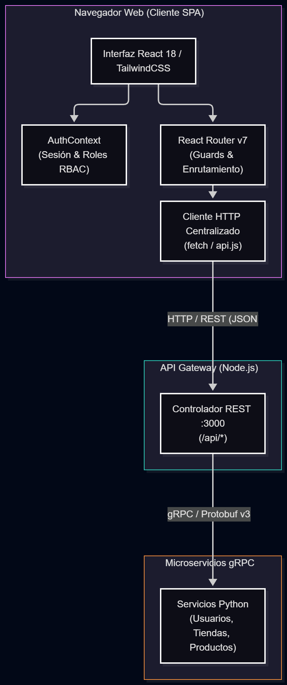

# 💻 Stockearte - Frontend Web

Frontend web del sistema distribuido **Stockearte**. Funciona como una Single Page Application (SPA) construida con **React 18**, **Vite** y **TailwindCSS**. Administra el catálogo de productos, sucursales físicas, usuarios y stock según el rol del operador.

La aplicación consume los endpoints REST expuestos por el **API Gateway** (Node.js). No se comunica directamente con los microservicios gRPC en Python.

---

## 1. Arquitectura y Componentes

La aplicación utiliza el patrón Single Page Application (SPA) con Client-Side Rendering (CSR). React Router resuelve la navegación del lado del cliente sin recargar la página.

<p align="center">
  
</p>

### Componentes Principales:
* **Módulos por dominio (`src/features/`):** Agrupan la lógica en cuatro dominios (`auth`, `tiendas`, `usuarios`, `productos`). Cada carpeta contiene sus vistas, componentes y servicios HTTP.
* **Cliente HTTP centralizado (`src/config/api.js`):** Envuelve llamadas `fetch` mediante la función `request()`. Estandariza cabeceras JSON, resuelve la URL base y normaliza los errores HTTP.
* **Contexto de autenticación (`src/context/AuthContext.jsx`):** Almacena el estado del usuario en memoria y sincroniza la sesión con `localStorage`. Expone helpers de autorización (`isCasaCentral`, `isTienda`).
* **Enrutamiento y guards (`src/routes/`):** `AppRoutes.jsx` define las rutas públicas y protegidas. `ProtectedRoute.jsx` restringe el acceso según el rol del usuario.
* **Layout y UI (`src/components/`):** `MainLayout.jsx` estructura la pantalla con `Navbar.jsx` y `Footer.jsx`. `Toast.jsx` muestra alertas temporizadas de éxito, error o advertencia.

---

## 2. Tecnologías y Librerías Principales

| Tecnología | Versión | Rol / Propósito |
| :--- | :---: | :--- |
| **React** | `^18.3.1` | Construcción de la interfaz mediante componentes funcionales y Hooks |
| **Vite** | `^5.4.11` | Bundler y servidor de desarrollo con Hot Module Replacement (HMR) sobre ES Modules |
| **React Router DOM** | `^7.18.5` | Enrutamiento declarativo del lado del cliente y protección de rutas |
| **TailwindCSS** | `^3.4.15` | Estilos utilitarios y diseño responsive con soporte de dark mode |
| **Lucide React** | `^0.460.0` | Iconografía en formato SVG para componentes React |
| **PostCSS & Autoprefixer** | `^8.4.49` / `^10.4.20` | Procesamiento y compatibilidad automática de reglas CSS |
| **Nginx Alpine** | `alpine` | Servidor web estático y reverse proxy en contenedor Docker |

---

## 3. Estructura del Proyecto

El código fuente utiliza una arquitectura modular por features (`src/features/`):

```bash
frontend/
├── Dockerfile                  # Multi-stage build: compilación en Node 20 y servidor Nginx Alpine
├── nginx.conf                  # Configuración de Nginx: SPA fallback (try_files) y reverse proxy /api/
├── package.json                # Dependencias, scripts y metadatos del proyecto
├── postcss.config.js           # Configuración de PostCSS para TailwindCSS y Autoprefixer
├── tailwind.config.js          # Configuración de colores, fuentes y utilidades de estilo
├── vite.config.js              # Configuración de Vite y plugin de React
├── index.html                  # Plantilla HTML base y punto de entrada al DOM
└── src/
    ├── main.jsx                # Punto de entrada de React (montaje en #root)
    ├── App.jsx                 # Configuración de Providers (AuthProvider y BrowserRouter)
    ├── index.css               # Directivas de TailwindCSS y estilos globales
    ├── config/
    │   └── api.js              # Cliente HTTP base con manejo uniforme de fetch y errores
    ├── context/
    │   └── AuthContext.jsx      # Contexto de autenticación, sesión en localStorage y roles
    ├── routes/
    │   ├── AppRoutes.jsx       # Definición de rutas públicas, privadas y redirecciones
    │   ├── ProtectedRoute.jsx  # Guard de navegación por rol y autenticación
    │   └── index.js            # Punto de exportación de rutas
    ├── components/
    │   ├── layout/
    │   │   ├── MainLayout.jsx  # Contenedor común (Navbar, Outlet de contenido y Footer)
    │   │   ├── Navbar.jsx      # Barra de navegación con badge de rol y selector de vistas
    │   │   └── Footer.jsx      # Pie de página con créditos y enlace a Swagger UI
    │   └── ui/
    │       └── Toast.jsx       # Componente de notificaciones flotantes temporizadas
    └── features/
        ├── auth/               # LoginView y authService
        ├── tiendas/            # TiendasView y modales de asignación de usuarios y productos
        ├── usuarios/           # UsuariosView y modales de alta y edición de operadores
        └── productos/          # ProductosView, filtros combinados y modales de stock
```

---

## 4. Requisitos Previos y Configuración

Requisitos para ejecutar el frontend:

* **Node.js:** Versión `18.x` o superior (`node -v`).
* **Gestor de paquetes:** `npm` (v9+) o `pnpm`.
* **API Gateway en ejecución:** El controlador REST debe escuchar en el puerto `3000` (`http://localhost:3000`).

### Variables de Entorno

Vite inyecta en el cliente únicamente las variables que inician con el prefijo `VITE_`:

| Variable | Tipo | Valor por Defecto | Descripción |
| :--- | :---: | :---: | :--- |
| `VITE_API_URL` | String | `http://localhost:3000/api` | URL base del API Gateway REST |

### Plantilla de archivo `.env`:

```env
# URL base del API Gateway REST
VITE_API_URL=http://localhost:3000/api
```

> Las variables con prefijo `VITE_` quedan expuestas en el bundle JavaScript del navegador. No incluyas credenciales privadas ni secretos de infraestructura en este archivo.

---

## 5. Instalación y Ejecución

### Opción A: Despliegue con Docker Compose (Producción)

El archivo `Dockerfile` ejecuta un build en dos etapas:
1. **Compilación:** `node:20-alpine` instala dependencias y genera los estáticos en `dist/`.
2. **Servidor web:** `nginx:alpine` copia el directorio `dist/` y sirve los archivos en el puerto `80`.

Desde la raíz del repositorio:

```bash
# Iniciar todos los servicios del proyecto
docker compose up --build -d

# Recompilar únicamente el frontend
docker compose up --build -d frontend
```

Acceso en el navegador: `http://localhost:80` (o `http://localhost`).

---

### Opción B: Ejecución Local en Desarrollo (Vite)

1. Entrar al directorio del frontend:
   ```bash
   cd frontend
   ```
2. Instalar dependencias:
   ```bash
   npm install
   ```
3. Iniciar el servidor de desarrollo con HMR:
   ```bash
   npm run dev
   ```
4. Abrir en el navegador: `http://localhost:5173`

### Scripts Disponibles:

* `npm run build` — Compila la aplicación y genera la salida en `dist/`.
* `npm run preview` — Inicia un servidor local para probar los archivos de `dist/`.
* `npm run lint` — Ejecuta ESLint sobre el código fuente.

---

## 6. Resumen de Funcionalidades

La aplicación adapta sus vistas según el rol del usuario (`CASA_CENTRAL` o `TIENDA`):

### 1. Acceso y Control de Sesión
* **Login:** Autentica usuario y contraseña contra el backend y almacena la sesión.
* **Persistencia de sesión:** Mantiene el usuario activo tras recargar la página mediante `localStorage`.
* **Logout:** Limpia los datos de sesión y redirige a `/login`.

### 2. Gestión de Sucursales (Casa Central)
* **Alta y edición de tiendas:** Crea y actualiza tiendas con código, dirección, ciudad y provincia.
* **Búsqueda y filtros:** Filtra sucursales por código y por estado (habilitada o inhabilitada).
* **Control operativo:** Modifica el estado de habilitación de una tienda con impacto inmediato.
* **Asignación de personal:** Vincula operadores de Casa Central a una sucursal o los desasigna.
* **Asignación de catálogo:** Vincula productos del catálogo general a la tienda con stock inicial en cero.

### 3. Administración de Personal (Casa Central)
* **Alta de operadores:** Registra usuarios con rol (`CASA_CENTRAL` o `TIENDA`) y tienda asignada.
* **Búsqueda y filtros:** Busca operadores por nombre de usuario o por tienda.
* **Modificación de cuentas:** Edita datos personales, contraseña y estado de habilitación.
* **Baja de usuarios:** Elimina operadores del sistema.

### 4. Catálogo y Control de Inventario
* **Alta de productos:** Registra artículos con código inmutable de 10 caracteres, nombre, talle, color y URL de imagen.
* **Búsqueda en tiempo real:** Filtra simultáneamente por nombre, código, talle y color.
* **Stock global (Casa Central):** Muestra el stock disponible de cada producto desglosado por tienda.
* **Gestión de stock local (Tienda):** Modifica las unidades disponibles de la tienda asignada.
* **Bloqueo preventivo:** Deshabilita los controles de stock si la sucursal está inhabilitada.

---

## 7. Seguridad y Autenticación

1. **Control de acceso por roles (RBAC):**
   * `ProtectedRoute.jsx` verifica si existe una sesión activa y compara `user.rol` con la lista de roles permitidos.
   * Si un usuario con rol `TIENDA` intenta entrar a `/tiendas` o `/usuarios`, el router lo redirige a `/productos`.
2. **Navegación condicional:**
   * `Navbar.jsx` muestra u oculta las opciones de menú según el rol del usuario activo.
3. **Cabeceras de seguridad en Nginx:**
   El contenedor de producción aplica cabeceras HTTP de protección:
   * `X-Frame-Options: SAMEORIGIN` — Evita ataques de Clickjacking.
   * `X-Content-Type-Options: nosniff` — Bloquea la detección incorrecta de tipos MIME.
   * `X-XSS-Protection: 1; mode=block` — Activa el filtro contra Cross-Site Scripting.
   * `Referrer-Policy: strict-origin-when-cross-origin` — Controla el envío de la cabecera Referer.
   * `server_tokens off` — Oculta la versión de Nginx en las respuestas HTTP.
4. **Validación de entradas:**
   * Los formularios validan campos obligatorios, longitud de códigos y valores numéricos antes de enviar las peticiones.

---

## 8. Manejo de Errores

El frontend gestiona los errores de red y de negocio en varios niveles:

* **Normalización en cliente HTTP (`src/config/api.js`):**
  * La función `request()` evalúa `response.ok`.
  * Si la respuesta falla, extrae `data.mensaje` o arma un error con el código HTTP (`error.status`).
* **Mapeo de respuestas HTTP:**
  * `401 Unauthorized`: Notifica credenciales incorrectas.
  * `403 Forbidden`: Informa que el usuario o la tienda están inhabilitados.
  * `404 Not Found`: Informa que el recurso solicitado no existe.
  * `500 Internal Server Error`: Muestra un mensaje de error del servidor sin exponer detalles internos.
* **Feedback visual con `Toast.jsx`:**
  * Alertas flotantes con duración de 4 segundos:
    * 🟢 **Verde:** Operaciones exitosas (altas, modificaciones, ajustes de stock).
    * 🔴 **Rojo:** Errores de validación, rechazos de autenticación o caídas de red.
    * 🟡 **Amarillo:** Advertencias y bloqueos por sucursal inhabilitada.
* **Estados de carga:**
  * Muestra indicadores de carga en botones y tablas para evitar envíos duplicados durante las peticiones.

---

## 9. Decisiones Técnicas Destacadas

### 1. Arquitectura Modular por Features
El código se organiza en `src/features/` según el dominio de negocio (`auth`, `tiendas`, `usuarios`, `productos`). Cada feature encapsula sus vistas, componentes y llamadas a la API. Esto reduce el acoplamiento y centraliza los cambios en un solo lugar.

### 2. Uso de Vite frente a Bundlers Tradicionales
Se eligió Vite en lugar de herramientas basadas en Webpack por dos razones técnicas:
* Usa ES Modules nativos en desarrollo, eliminando el proceso de empaquetado inicial.
* Ofrece Hot Module Replacement (HMR) rápido, actualizando componentes sin perder el estado local.
* En producción compila con Rollup y genera chunks divididos por rutas.

### 3. Aislamiento del Protocolo gRPC
El frontend se comunica únicamente con el API Gateway mediante JSON sobre HTTP. No procesa archivos `.proto` ni abre canales gRPC. Esta separación desacopla la interfaz del cliente web respecto a los contratos internos de los microservicios.

### 4. Enrutamiento SPA con Nginx (`try_files`)
El servidor Nginx incluye la directiva `try_files $uri $uri/ /index.html;`. Cuando el usuario recarga la página en rutas del cliente (como `/productos` o `/tiendas`), Nginx entrega siempre `index.html` para que React Router resuelva la ruta sin devolver un error 404.

### 5. Reverse Proxy `/api/` en Producción
La configuración de Nginx redirige las solicitudes dirigidas a `/api/` hacia el contenedor del API Gateway (`http://controller:3000/api/`). Ambos componentes comparten el mismo host y puerto en producción, lo que evita configuraciones adicionales de CORS.

---

## 10. Recursos Adicionales

- [**Documentación Oficial de React**](https://react.dev/): Guías y referencia de API de React 18.
- [**Documentación Oficial de Vite**](https://vitejs.dev/): Configuración del bundler y plugins.
- [**Documentación Oficial de TailwindCSS**](https://tailwindcss.com/docs): Catálogo de clases utilitarias y directivas.
- [**Documentación Oficial de React Router**](https://reactrouter.com/): Enrutamiento del cliente y layouts anidados.
- [**Documentación Oficial de Nginx**](https://nginx.org/en/docs/): Configuración de servidor web, proxy inverso y compresión gzip.
